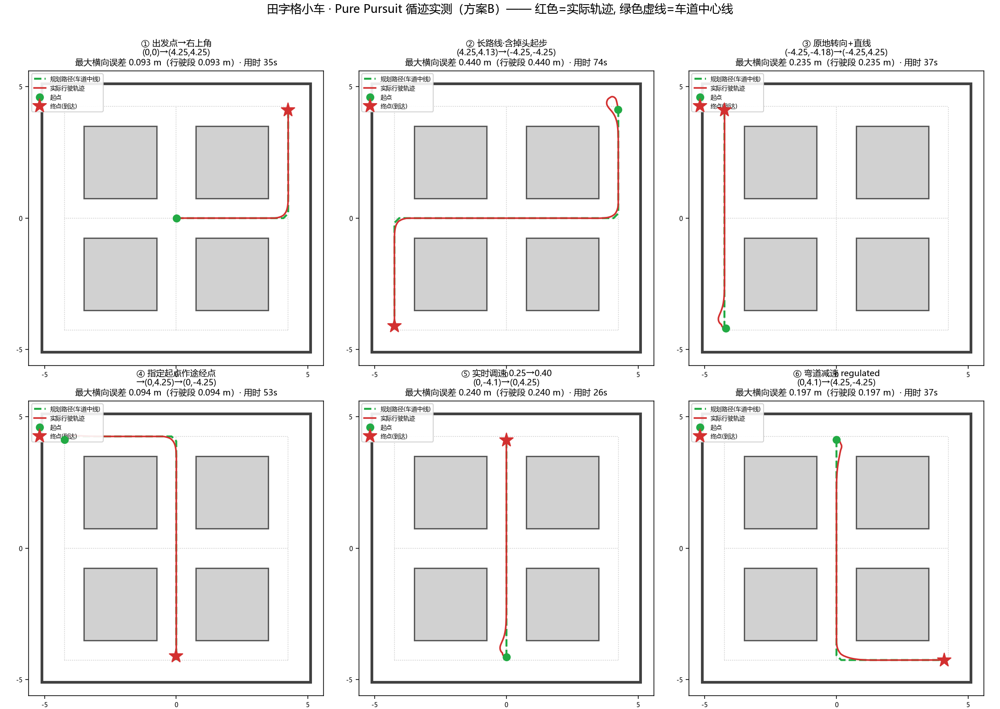
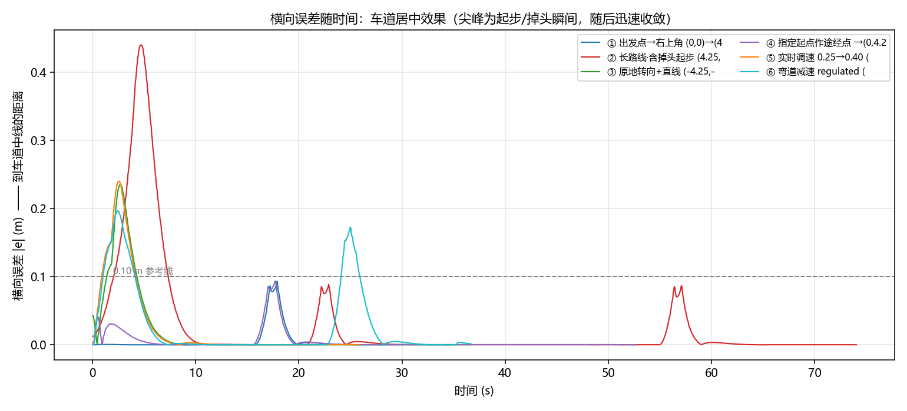
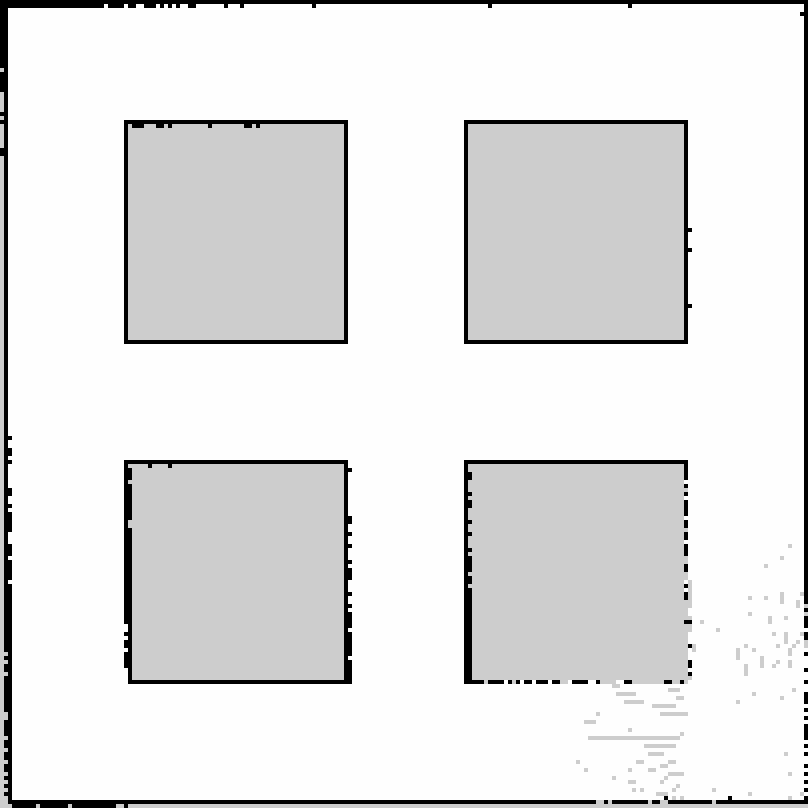

# 田字格循迹小车 · ROS2 仿真全流程

[](https://docs.ros.org/en/humble/)
[](https://gazebosim.org/)
[](https://www.python.org/)
[](LICENSE)

基于 **ROS2 Humble + Gazebo 11** 的"田字格"赛道循迹小车全流程项目：
自建仿真场地与差速小车模型 → SLAM 建图 → **手写 Pure Pursuit 算法**实现
"车道居中行驶 + 点选起点终点 + 设定速度"的自主导航。



> 红色 = 实际行驶轨迹，绿色虚线 = 车道中心线。六次实测全部精确贴线到达目标点。

---

## ✨ 项目亮点

- 🏟 **自建仿真环境**：10×10 m 田字格场地（四个 2.75 m 方块 + 1.5 m 走廊），
  四轮差速小车（0.50×0.36 m，顶部 360° 激光雷达，0.12~10 m）
- 🗺 **完整建图流程**：slam_toolbox（Ceres 后端）在线建图，遥控扫图 → 保存地图
- 🚗 **纯手写导航算法**（不依赖 Nav2，约 460 行 Python，全中文注释）：
  - 路径规划：走廊**车道中心线网络**（田字的 "#" 骨架）+ Dijkstra 最短路由 + 拐角切角
  - 循迹控制：**Pure Pursuit 前视追踪 + PID 横向纠偏**，20 Hz 闭环
  - 工程细节：目标在身后时**原地转向**、雷达安全保护、弯道自动减速、CSV 运行记录
- 📐 **实测效果**：常规行驶（直道 + 直角弯）横向误差 **≤ 9.4 cm**（走廊宽 1.5 m）
- 🎯 **交互方式**：RViz 里点两下（`2D Pose Estimate` + `2D Goal Pose`）即自动出发；
  速度运行中可实时调整

---

## 🧭 全流程概览

```
┌──────────────┐    ┌──────────────┐    ┌──────────────┐    ┌──────────────┐
│ ① 建仿真环境 │ →  │ ② SLAM 建图  │ →  │ ③ 保存地图   │ →  │ ④ 自主导航   │
│ 场地+小车模型│    │ 遥控扫田字格 │    │ pgm+yaml     │    │ 循迹/选点/调速│
└──────────────┘    └──────────────┘    └──────────────┘    └──────────────┘
```

| 阶段 | 内容 | 对应文件 |
|---|---|---|
| ① 仿真环境 | Gazebo 世界 + URDF 小车（差速驱动/激光雷达）+ launch | `ros2_ws/src/my_gazebo/{worlds,urdf,launch}` |
| ② SLAM 建图 | slam_toolbox 在线异步建图 + RViz 可视化 | `config/slam_params.yaml`、`config/slam_view.rviz`、`launch/slam.launch.py` |
| ③ 保存地图 | map_saver_cli 保存 pgm/yaml | `scripts/save_map.sh`、`maps/` |
| ④ 自主导航 | 自写 Pure Pursuit 节点 + RViz 导航界面（方案B） | `scripts/pure_pursuit_nav.py`、`config/nav_view.rviz`、`launch/nav_pp.launch.py` |

---

## 📁 目录结构

```
tian-grid-car-nav/
├── ros2_ws/src/my_gazebo/        # ROS2 功能包（ament_cmake）
│   ├── worlds/square_10m.world   # 田字格场地：10×10m 外墙 + 四个 2.75m 方块
│   ├── urdf/my_car.urdf          # 差速小车：0.50×0.36m + 360° 激光（10Hz）
│   ├── launch/
│   │   ├── square_10m.launch.py  # 仅启动世界
│   │   ├── my_car.launch.py      # 世界 + robot_state_publisher + 生成小车
│   │   ├── slam.launch.py        # slam_toolbox 建图 + RViz
│   │   └── nav_pp.launch.py      # 导航节点 + RViz 导航界面
│   ├── config/
│   │   ├── slam_params.yaml      # slam_toolbox 参数
│   │   ├── slam_view.rviz        # 建图 RViz 界面
│   │   └── nav_view.rviz         # 导航 RViz 界面（俯视图+选点工具+路径显示）
│   └── scripts/pure_pursuit_nav.py  # ★ 自主导航节点（核心，~460 行）
├── scripts/                      # 虚拟机家目录脚本（复制到 ~/ 使用）
│   ├── ros_env.sh                # 统一环境变量（ROS2 + Gazebo + DOMAIN_ID）
│   ├── start_car.sh              # 启动仿真（世界+小车）
│   ├── start_slam.sh             # 启动 SLAM 建图 + RViz
│   ├── start_square.sh           # 仅启动场地
│   ├── save_map.sh               # 保存地图
│   ├── start_pp_nav.sh           # ★ 启动自主导航 + RViz 导航界面
│   ├── pp_point.sh               # 命令行发送起点/终点（不用 RViz 时）
│   ├── stop_sim.sh               # 一键停止所有程序
│   └── clean_gazebo.sh           # 清理全部相关进程
├── maps/                         # 已扫描好的地图（可直接使用）
│   ├── tian_map.pgm
│   └── tian_map.yaml
├── docs/
│   ├── manual.md                 # 完整操作手册（建图/导航/参数/排错）
│   ├── navigation-report.md      # 导航方案交付说明（设计与实测）
│   └── images/                   # 效果图
├── test_data/                    # 六次实测运行记录（轨迹 CSV + 规划路径）
└── LICENSE
```

---

## 🚀 快速开始

### 0. 环境要求

- Ubuntu 22.04 + **ROS2 Humble**
- Gazebo 11（`ros-humble-gazebo-ros-pkgs`）
- `slam_toolbox`（建图用）、`teleop_twist_keyboard`（遥控扫图用）、`nav2_map_server`（保存地图，`map_saver_cli`）

```bash
sudo apt install ros-humble-gazebo-ros-pkgs ros-humble-slam-toolbox \
                 ros-humble-teleop-twist-keyboard ros-humble-nav2-map-server
```

### 1. 安装

```bash
# 工作空间
mkdir -p ~/gazebo_ws/src && cp -r ros2_ws/src/my_gazebo ~/gazebo_ws/src/
cd ~/gazebo_ws && colcon build --packages-select my_gazebo
source install/setup.bash

# 家目录脚本
cp scripts/*.sh ~/ && chmod +x ~/*.sh

# 地图（可选，直接跳过建图）
mkdir -p ~/maps && cp maps/tian_map.* ~/maps/
```

### 2. 启动仿真

```bash
# 终端 1
~/start_car.sh     # 等待约 30~60 秒，Gazebo 中出现田字格 + 橙色小车
```

### 3. SLAM 建图（可选 —— 仓库已附扫好的地图）

```bash
# 终端 2：启动 slam_toolbox + RViz
~/start_slam.sh

# 终端 3：键盘遥控，慢速绕外圈和十字走廊各走一遍
ros2 run teleop_twist_keyboard teleop_twist_keyboard

# 扫完后保存地图
~/save_map.sh      # 输出 ~/maps/tian_map.pgm + .yaml
```

### 4. 自主导航（核心）

```bash
# 终端 2（仿真运行中）
~/start_pp_nav.sh          # 启动导航节点 + RViz 导航界面
```

在 RViz 中：

1. 点工具栏 **`2D Pose Estimate`**，在小车当前位置点一下（选起点，可选）
2. 点 **`2D Goal Pose`**，点想要去的终点 → **小车自动出发，到点自动停车**

> 不用 RViz 也可以：`~/pp_point.sh goal 4.25 4.25`

调速（运行中实时生效）：

```bash
ros2 param set /pure_pursuit_nav speed 0.40
```

---

## 🧠 算法说明

### 1. 路径 = 车道中心线网络

田字格场地的可行驶走廊中心线构成 **3 横 3 纵** 的 "#" 网络（坐标 ±4.25 / 0）。
任意点选位置先**吸附到最近的中心线**，再在网络图上用 **Dijkstra** 求最短路由，
拐角处做 0.18 m **切角**（chamfer）减小过弯偏差。路径天然通过走廊正中心。

### 2. Pure Pursuit 循迹

每个控制周期（20 Hz）：

1. 在路径上取车前视距离 `L` 处的点作为追踪目标（`L = clamp(1.6·v, 0.35, 0.60)`）
2. 曲率 `κ = 2·sin(α) / L`，角速度 `ω = κ·v`，与线速度一起发布到 `/cmd_vel`

### 3. PID 横向纠偏（叠加在 Pure Pursuit 上）

实时计算车到中心线的横向误差 `e`（带符号），用 PID 输出附加角速度修正 `ω - Kp·e - Kd·ė`，
加快回中线、抑制残差。横向误差全周期记录在运行 CSV 中可复盘。

### 4. 工程细节

| 机制 | 作用 |
|---|---|
| 原地转向 | 目标在车身后方（夹角 >115°）时先原地旋转对准，再行驶（避免 Pure Pursuit 在 180° 反向时画大弧） |
| 雷达安全保护 | 前方 ±35° 扇区内：<0.2 m 停车、<0.5 m 减速 |
| 终点减速 | 距终点 <0.5 m 时按距离比例减速，平稳停车 |
| 弯道减速（可选） | `regulated:=true` 时按前视夹角自动降速 |
| 运行记录 | 每次任务自动写 `~/pp_log/pp_run_*.csv`（时间/坐标/速度/横偏/剩余距离） |

---

## 📊 实测结果

六次仿真任务全部成功到达（2026-10-12 实测，走廊宽 1.5 m，巡航速度 0.25 m/s）：

| # | 场景 | 结果 | 用时 | 最大横向误差* |
|---|---|---|---|---|
| ① | 起点 → 右上角（含直角弯） | ✅ 到达 | 35 s | **0.093 m** |
| ② | 17.9 m 长路线（掉头起步） | ✅ 到达 | 74 s | 0.440 m |
| ③ | 原地转向 + 直线 8.5 m | ✅ 到达 | 37 s | 0.235 m |
| ④ | 指定起点作途经点（2 个直角弯） | ✅ 到达 | 53 s | **0.094 m** |
| ⑤ | 实时调速 0.25→0.40 m/s | ✅ 到达 | 26 s | 0.240 m |
| ⑥ | 弯道自动减速（regulated） | ✅ 到达 | 37 s | 0.197 m |

\* 横向误差 = 小车中心到车道中线的距离。**常规行驶（直道+弯道）≤ 9.4 cm**；
较大数值仅出现在掉头/转向起步的 2~3 秒暂态，随后迅速收敛回中线（见误差曲线）。



### 地图（slam_toolbox 实扫）



---

## ⚙️ 关键参数

| 参数 | 默认 | 说明 |
|---|---|---|
| `speed` | 0.25 | 巡航速度 m/s（运行中可调） |
| `lookahead_min` / `lookahead_max` | 0.35 / 0.60 | 前视距离范围 m |
| `kp_lateral` / `kd_lateral` | 0.8 / 0.10 | PID 横向纠偏增益 |
| `corner_cut` | 0.18 | 路径拐角切角长度 m |
| `spin_alpha_threshold` | 2.0 | 夹角超过该值时先原地转向（rad） |
| `regulated` | false | 弯道自动减速开关 |
| `goal_tolerance` | 0.15 | 到达判定半径 m |
| `scan_stop_dist` / `scan_slow_dist` | 0.20 / 0.50 | 雷达安全距离 m |

完整参数列表与排查手册见 [`docs/manual.md`](docs/manual.md)。

---

## ❓ 常见问题

- **Gazebo 里没有小车？** 生成偶尔会超时：`Ctrl+C` 停掉后重新 `~/start_car.sh` 即可。
- **导航节点提示"等待 /odom"？** 说明仿真没启动，先运行 `~/start_car.sh`。
- **为什么掉头时先原地转？** Pure Pursuit 在目标接近正后方时 sin(α)≈0 会画大弧，原地转向更稳。
- **想更贴近终点？** `ros2 param set /pure_pursuit_nav goal_tolerance 0.08`。
- **一键关闭所有程序？** `~/stop_sim.sh`（仿真/建图/导航/RViz/遥控全部停止）。

---

## 📄 License

[MIT](LICENSE) © 2026 ll-xuyan

> 本项目为 ROS2 学习/课程实践项目，仿真环境与算法实现均为原创，
> 欢迎 Issue / Star ⭐
